# CostX Model Mapping: a Claude skill

**Turn a Revit model into clean, floor-level-split RIB CostX dimension groups, ready for an NRM2 Bill of Quantities.**

This is a [Claude skill](https://docs.claude.com/en/docs/agents-and-tools/agent-skills/overview):
a packaged set of instructions Claude follows to do a task end to end. It works two ways:

- **With Claude** (Claude app, Claude Code, or Claude with computer use): install the skill
  and Claude follows it to export the IFC, build the CostX Model Map, preview, import and
  fix problems on your machine.
- **Without Claude**: [`SKILL.md`](SKILL.md) is also a complete step-by-step manual you can follow yourself.

Every step was tested on a real 2-storey house in **RIB CostX 7.1** with an IFC from
**Revit 2026/2027**, and the pitfalls listed are ones that actually happened.

Companion skill → **[costx-nrm2-boq-skill](https://github.com/ahnaf-salaahi/costx-nrm2-boq-skill)**
(builds the NRM2 BOQ workbook from these dimension groups).

---

## What you get

| | |
|---|---|
| `SKILL.md` | The skill: IFC export → Model Map → preview → import → fix duplicates, with a property table for every element type |
| `references/expressions.md` | Copy-paste Folder / Group / quantity expressions for walls, slabs, roof, ceilings, rooms, doors, windows, railings, stair, sanitary and paving |
| `references/troubleshooting.md` | Every error seen in practice and its fix |
| `tools/check_ifc.py` | Pre-flight check: base quantities present? levels? wrong materials? missing structure? |
| `tools/ifc_takeoff.py` | Independent quantity take-off from the IFC, to cross-check CostX totals |

## Result

Dimension groups arranged NRM2-style, with superstructure split by floor:

```
2 SUBSTRUCTURE\5 EXCAVATION AND FILLING
2 SUBSTRUCTURE\11 IN-SITU CONCRETE          (ground slab, via an IF() rule)
3 SUPERSTRUCTURE\L1\14 MASONRY | 20 CEILINGS | 23 WINDOWS | 24 DOORS | 25 STAIRS | 28 FLOOR FINISHES | 32 SANITARY
3 SUPERSTRUCTURE\L2\11 IN-SITU CONCRETE | 14 MASONRY | …
3 SUPERSTRUCTURE\L3 ROOF\18 ROOF COVERINGS
4 EXTERNAL WORKS\35 SITE WORKS
```

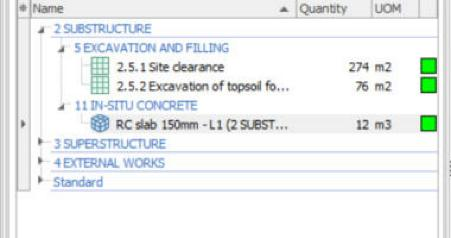

---

## Install

### Claude app (claude.ai / desktop)
1. Download this repo as a ZIP (**Code → Download ZIP**).
2. In Claude, open **Settings** and find **Skills** (under Capabilities), then upload the ZIP.
   Skills must be enabled for your account (see Anthropic's help pages).
3. Ask: *"Use the costx-model-mapping skill to map my IFC in CostX."*

### Claude Code
```bash
git clone https://github.com/ahnaf-salaahi/costx-model-mapping-skill ~/.claude/skills/costx-model-mapping
```

### Tools (optional)
```bash
pip install -r tools/requirements.txt
python tools/check_ifc.py MyModel.ifc
python tools/ifc_takeoff.py MyModel.ifc takeoff.json
```

---

## Walkthrough (screenshots)

### 1. Export the IFC with base quantities
The built-in setups are locked. **Duplicate** one, then under *Property Mapping → "…"* tick
**Export base quantities** and **Export Revit property sets**.

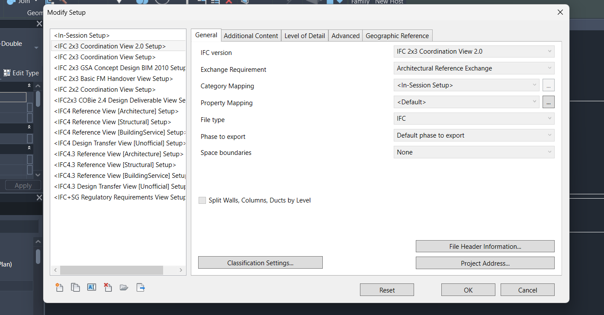

### 2. The Model Map editor
Tree (top left), Mapping Definition (bottom left), Schedule (bottom). Bold tree nodes have mappings.

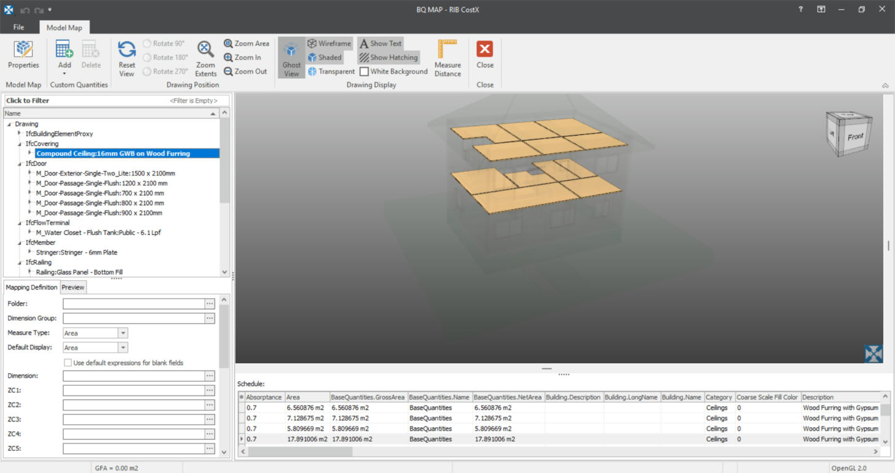

### 3. Folder expressions: text in quotes, properties in [ ], joined with &
`"3 SUPERSTRUCTURE\" & [Level] & "\20 CEILINGS"`

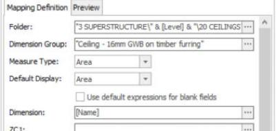

### 4. ⚠️ Quantities go in the *lower* fields, not "Dimension"
*Dimension* is only the line label. Scroll down to **Length / Area / Volume**. This is the
number one reason for "the quantity shows 0".

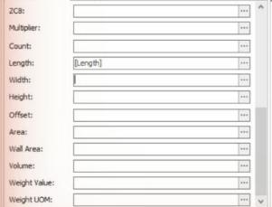

Roof example (use **Gross**, because the roof NetArea from Revit is wrong):

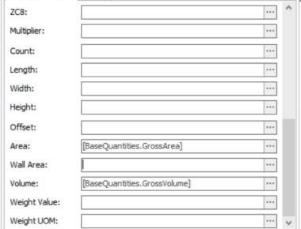

### 5. Conditions use IF(), not IIF()
The expression editor's **Functions** tab lists valid functions.

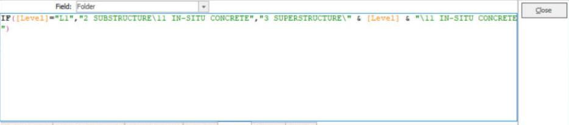

One mapping, two parts: the ground slab goes to Substructure and upper slabs to Superstructure:

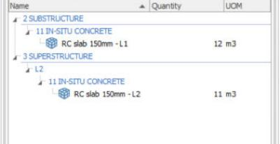

### 6. Preview before importing

| Ceilings by level | Doors (count) | Walls by level |
|---|---|---|
| 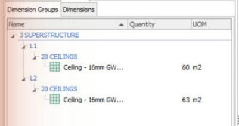 | 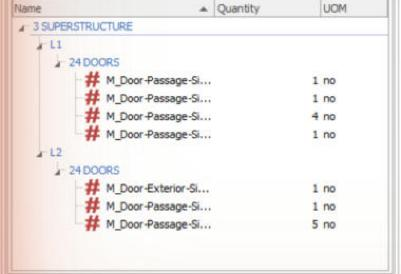 | 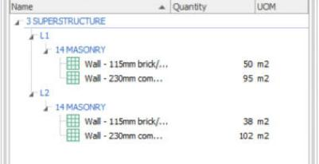 |

Toposolid paving (map each instance):

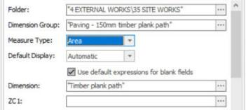

### 7. Import, and how to re-import cleanly
Click **Show All Objects** first, then *Import ▾ → Import Dimensions Using Model Map*.

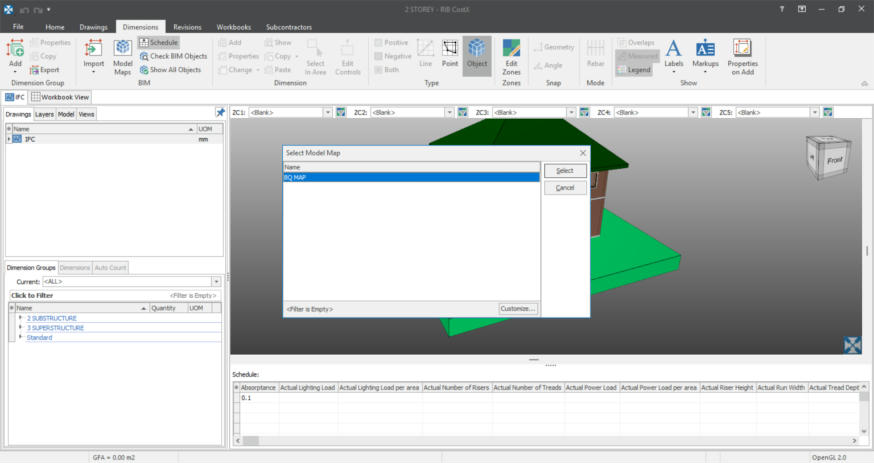

Re-importing **adds** copies with a `(folder)` suffix. Right-click the old folders →
**Delete Folder**, then import again.

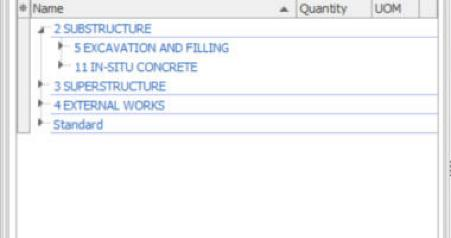

---

## Property cheat sheet

| Element | Quantity fields |
|---|---|
| Walls | Area `[Area]`, Length `[Length]`, Volume `[BaseQuantities.NetVolume]` |
| Floor slabs | Volume `[BaseQuantities.NetVolume]`, Area `[Area]`, Length `[BaseQuantities.Perimeter]` |
| Roof | Area `[BaseQuantities.GrossArea]`, Volume `[BaseQuantities.GrossVolume]` |
| Ceilings | Area `[BaseQuantities.NetArea]` |
| Rooms | Area `[BaseQuantities.NetFloorArea]`, Length `[BaseQuantities.GrossPerimeter]` |
| Railings | Length `[Length]` |
| Doors, windows, stair, WC | Count |
| Paving (toposolid) | Area `[Area]` |

Level property: walls `[Base Constraint]`, railings `[Base Level]`, everything else `[Level]`.

---

## Limitations
- Tested on CostX 7.1. Menu names may differ slightly in other versions.
- Anything not modelled (foundations, columns, beams, rebar, drainage, services) must be
  measured manually in CostX from 2D drawings.
- Revit property names (`Base Constraint`, `Level`, `Base Level`) depend on the IFC export
  settings above.

## Credits
Created by **Ahnaf Salaahi** ([ahnaf-salaahi](https://github.com/ahnaf-salaahi)), BSc (Hons) Quantity Surveying, University of Moratuwa, 
developed during the QS4100 Building Information Modelling and Management coursework,
written with Claude.

MIT License.
