# CostX Model Mapping (Revit → IFC → CostX dimension groups)

This skill turns a Revit model into clean, level-split CostX dimension groups that a
Bill of Quantities can link to. Every rule here was tested on a real 2-storey project in
**CostX 7.1** with an IFC exported from **Revit 2026/2027**. Each pitfall listed below
actually happened during that test.

Companion skill: **costx-nrm2-boq** (builds the NRM2 workbook from these dimension groups).

---

## 0. Before you start: what you need

| Item | Why |
|---|---|
| Revit file opened in a Revit version **equal to or newer** than the one that saved it | Revit cannot open files saved in a newer version, and you cannot save down. Students: get the free Autodesk Education licence for the matching version. |
| CostX (any version) | IFC import works in every version. Direct RVT import only works up to the Revit version your CostX supports, so **always use IFC**. |
| The measurement standard (NRM2 assumed here) | Decides the folder names and which quantity each item needs. |

If you are an AI agent working through computer use, request access to **CostX** *and* its
window-owning helper process (`csx64_host.exe` on Windows); otherwise screenshots show a
masked window. Restoring a minimised window from the taskbar also needs the **File Explorer**
(shell) grant.

---

## 1. Export the IFC from Revit (with quantities)

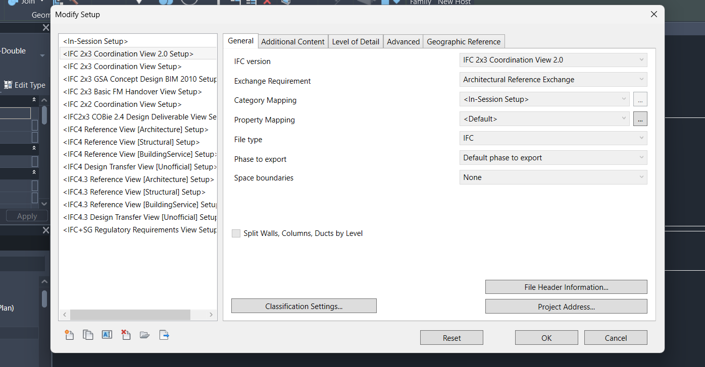

1. In Revit open a **3D view** that shows only what you will measure (hide furniture,
   annotation, entourage). Name it `CostX Export`.
2. **File → Export → IFC → Modify setup…**
3. Built-in setups in `<angle brackets>` are **locked** (every box greyed out). Select
   `<IFC 2x3 Coordination View 2.0 Setup>` and click the **Duplicate** icon (second icon at
   the bottom left). Name it `CostX`.
4. On the **General** tab tick **Split Walls, Columns, Ducts by Level**.
5. **Property Mapping → "…"**. In Revit 2025+ the old *Property Sets* tab moved here.
   Duplicate `<Default>` if it is locked, then tick:
   - **Export base quantities** (without this, CostX has no NetArea / NetVolume)
   - **Export Revit property sets** (carries Description, Level, Base Constraint …)
   - **Export IFC common property sets**
6. On **Additional Content** tick *Export only elements visible in view* and *Export rooms*
   (needed for floor finishes and skirting).
7. Make sure **CostX** is the selected setup, export, and save as `Project_v2.ifc`.

### Optional but recommended: check the IFC before CostX
Run `tools/check_ifc.py your.ifc` (needs `pip install ifcopenshell`). It reports:
- whether `BaseQuantities` exist (if the count is 0, go back and redo step 5)
- the storeys (levels) and element counts per IFC class
- model problems that break mapping: wrong materials, partitions flagged `IsExternal`,
  unnamed rooms, and missing structure (foundations, columns, beams)

---

## 2. Open the Model Map editor

Dimensions ribbon → **Model Maps** → *Global* tab → **Insert** (new) or select + **Edit**.
If double-click or Edit does nothing, select the row and click **Edit** again; it can take a
few seconds to open.

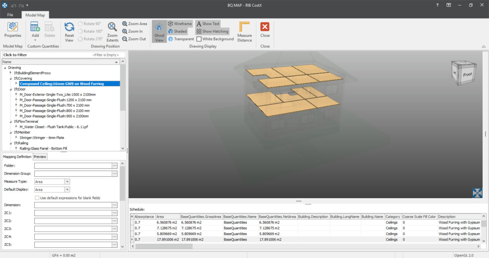

Layout:
- **Model tree** (top left): IFC class → Family:Type → instance. **Bold = has a mapping.**
- **Mapping Definition** (bottom left) holds the fields; **Preview** sits beside it.
- **Schedule** (bottom): every property of the selected elements, so you can read real values
  and exact property names here.

### Where to put a mapping
- Select the **IFC class** (e.g. `IfcDoor`) to map every type of that class at once.
- Select a **Family:Type** node to map just that type (best for walls, slabs, roofs).
- Select an **instance** only to fix a single odd element.
- ⚠️ An instance mapping **overrides** its type. A leftover, half-filled instance mapping
  causes the import error *"one or more dimension groups have a blank folder"*. Look for
  bold instances under a type and either complete them or clear all their fields.

---

## 3. The Mapping Definition fields: the part everyone gets wrong

| Field | What it really is |
|---|---|
| **Folder** | Folder path for the dimension group. Supports nesting and properties. |
| **Dimension Group** | Name of the group (the thing you link to the BOQ). |
| **Measure Type** | Count / Length / Area / Volume. Sets the group's primary unit. |
| **Default Display** | Leave Automatic. |
| **Use default expressions for blank fields** | Lets CostX guess values for blank fields. Keep it ticked, but do **not** rely on it for quantities. |
| **Dimension** | ⚠️ **Only the label of each line** (e.g. `[Name]`). It is **not** the quantity. |
| ZC1–ZC8 | Zone categories, optional (e.g. level). |
| **Multiplier, Count, Length, Width, Height, Offset, Area, Wall Area, Volume, Weight** | ⚠️ **The quantity fields.** They are below ZC8, so **scroll the panel down.** |

> If the Preview shows **0 m²**, the quantity field (Area / Length / Volume) is empty or
> holds the wrong property. Picking "Area" as Measure Type only sets the unit.

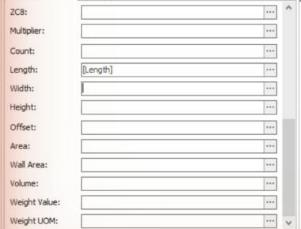

### Expression syntax (CostX 7)
- Text **must be in double quotes**: `"3 SUPERSTRUCTURE"`
- Properties in square brackets: `[Level]`, `[BaseQuantities.NetVolume]`
- Join with `&`: `"3 SUPERSTRUCTURE\" & [Level] & "\14 MASONRY"`
- **Backslash** inside the text creates nested folders.
- Conditions use **`IF(test, a, b)`**, **not** `IIF`. The **"…"** button opens the
  expression editor; its **Functions** tab lists every valid function.
- A **red box** around a field means the expression is invalid.
- Arithmetic works: `[BaseQuantities.NetVolume]/0.115`

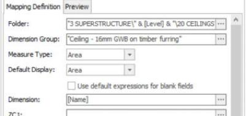
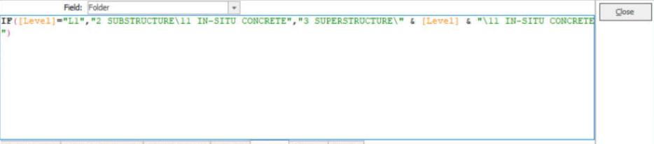

### Data entry tips that prevent lost input
- Click a field **twice** (or double-click) before typing; a single click often only
  selects the row.
- **Commit** a field by clicking another field (e.g. ZC1). If you jump straight to a
  dropdown or the tree, the text can be discarded.
- Re-check the field after committing. If it is blank, type it again.
- The tree scrolls and expands when you click it, so take a fresh screenshot before every
  click on a tree row.

---

## 4. Which property to use for each element (tested values)

Use the **Schedule** to confirm that a column exists and holds sensible numbers before you
use it.

| Element (IFC class) | Measure Type | Quantity fields | Notes from testing |
|---|---|---|---|
| External walls / partitions (`IfcWallStandardCase`) | Area | **Area** = `[Area]`, **Length** = `[Length]`, **Volume** = `[BaseQuantities.NetVolume]` | Revit `Area` = net side area (openings deducted). |
| Odd walls (`IfcWall`: edited profile, attached) | Area | **Area** = `[Area]` | Their `BaseQuantities` are incomplete (GrossSideArea was too low), but Revit `Area` is right. |
| Floor slabs (`IfcSlab` Floor:…) | Volume | **Volume** = `[BaseQuantities.NetVolume]`, **Area** = `[Area]`, **Length** = `[BaseQuantities.Perimeter]` | `BaseQuantities.NetArea` does **not** deduct the stair opening; Revit `Area` does. Perimeter is in mm, and CostX converts it. |
| Roof (`IfcSlab` Basic Roof:…) | Area | **Area** = `[BaseQuantities.GrossArea]`, **Volume** = `[BaseQuantities.GrossVolume]` | Roof **NetArea/NetVolume are wrong** (about 10% of real). Gross is the sloped area. |
| Ceilings (`IfcCovering`) | Area | **Area** = `[BaseQuantities.NetArea]` or `[Area]` | |
| Rooms (`IfcSpace`) | Area | **Area** = `[BaseQuantities.NetFloorArea]`, **Length** = `[BaseQuantities.GrossPerimeter]` | Label with `[LongName]`. `[Name]` triggers an "ambiguous property" warning. |
| Doors / Windows | Count | none | Group by `[Family and Type]`. |
| Stair (`IfcStair`) | Count | none | Do **not** map `IfcStairFlight` / `IfcMember` (they are parts of the stair). |
| Railings (`IfcRailing`) | Length | **Length** = `[Length]` | Revit Length is more accurate than geometry. |
| Toposolid paths (`IfcBuildingElementProxy`) | Area | **Area** = `[Area]` | Map each toposolid instance separately; don't map window trims/muntins (also proxies). |
| WC / fittings (`IfcFlowTerminal`) | Count | none | |

### Level property per class
| Class | Level property |
|---|---|
| Walls | `[Base Constraint]` |
| Slabs, doors, windows, ceilings, rooms, fittings | `[Level]` |
| Railings | `[Base Level]` (stair handrails can be **blank**, so map that instance with a fixed `L1` folder) |
| Roof | none (use a fixed `"...\L3 ROOF\..."` folder) |

---

## 5. Recommended folder layout (NRM2)

```
2 SUBSTRUCTURE\5 EXCAVATION AND FILLING
2 SUBSTRUCTURE\11 IN-SITU CONCRETE
3 SUPERSTRUCTURE\<Level>\11 IN-SITU CONCRETE
3 SUPERSTRUCTURE\<Level>\14 MASONRY
3 SUPERSTRUCTURE\<Level>\20 CEILINGS
3 SUPERSTRUCTURE\<Level>\23 WINDOWS
3 SUPERSTRUCTURE\<Level>\24 DOORS
3 SUPERSTRUCTURE\<Level>\25 STAIRS AND BALUSTRADES
3 SUPERSTRUCTURE\<Level>\28 FLOOR FINISHES
3 SUPERSTRUCTURE\<Level>\32 SANITARY FITTINGS
3 SUPERSTRUCTURE\L3 ROOF\18 ROOF COVERINGS
4 EXTERNAL WORKS\35 SITE WORKS
```

Ready-to-paste expressions are in `references/expressions.md`. The key one is the
ground slab going to Substructure and upper slabs to Superstructure from one mapping:

```
IF([Level]="L1","2 SUBSTRUCTURE\11 IN-SITU CONCRETE","3 SUPERSTRUCTURE\" & [Level] & "\11 IN-SITU CONCRETE")
```

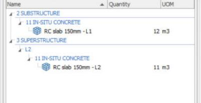

---

## 6. Step-by-step mapping order (do one class, preview, then continue)

For each row: select the node → Mapping Definition → fill the top fields → scroll down →
fill the quantity fields → **Preview**.

1. **Ceilings** (`IfcCovering` type): the easy first test. Expect total = sum of ceiling areas.
2. **Doors** (`IfcDoor` class): Count, group `[Family and Type]`.
3. **Windows** (`IfcWindow` class): same.
4. **WC / fittings** (`IfcFlowTerminal`).
5. **Railings** (`IfcRailing` class) with Length `[Length]`; then fix blank-level instances.
6. **Roof** (Basic Roof type): GrossArea / GrossVolume.
7. **Floor slabs** (Floor type): the IF() folder plus Volume / Area / Perimeter.
8. **Rooms** (`IfcSpace` class): NetFloorArea + GrossPerimeter, labelled `[LongName]`.
9. **Stair** (`IfcStair` class): Count.
10. **Walls**: each type under `IfcWallStandardCase` **and** `IfcWall`, with Area / Length / Volume.
    Use the **same Dimension Group name** for the same wall type in both classes.
11. **Paving** (toposolid instances): Area.

### Previewing
- Preview tab → **Dimension Groups** sub-tab, then expand the folders.
- To preview the **whole map**, select the top **Drawing** node in the tree.
- Hover a dimension group (after import) to see Count / Length / Area / Volume together.

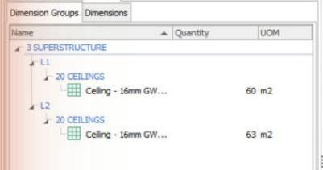
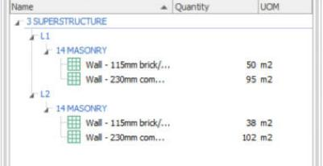

Close the editor with **Close** (top right of the Model Map ribbon). The map saves
automatically.

---

## 7. Import the dimension groups

1. Dimensions ribbon → **Show All Objects** first. ⚠️ The import only covers **visible**
   objects; if the 3D view is filtered to one element, you get one element.
2. **Import ▾ → Import Dimensions Using Model Map** → select your map → **Select**
   (or double-click it).

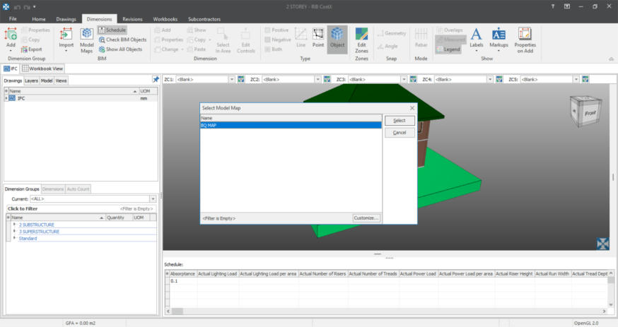
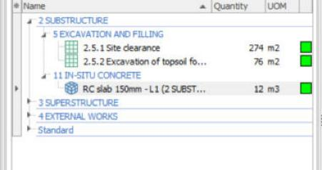

### Re-importing after editing the map (important)
CostX does **not** update existing groups. Groups whose mapping changed are created
**again**, with the folder path appended to the name, e.g.
`RC slab 150mm - L1 (2 SUBSTRUCTURE\11 IN-SITU CONCRETE)`.

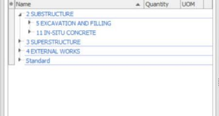

Clean way to re-import:
1. In Dimension Groups, **right-click** each model-generated folder → **Delete Folder** → Yes.
   (The **Delete key does nothing** here; use the right-click menu. For single groups use
   *Delete Dimension Group*.)
2. Leave hand-measured groups alone.
3. **Show All Objects** → import again.

### Group names you will need in the BOQ
When two groups share a name, CostX keeps the first plain and suffixes the others:
- `Wall - 115mm brick/block partition (3 SUPERSTRUCTURE\L2\14 MASONRY)`
- `Wall - 115mm brick/block partition 2 (3 SUPERSTRUCTURE\L2\14 MASONRY)`

To read an exact name: drag the group onto a workbook quantity cell; the
**Text To Be Inserted** box shows it. Then press Esc.

---

## 8. Verification checklist

- [ ] Every class you need is bold in the tree; window trims, stair flights and members are not.
- [ ] Whole-map preview shows no 0 values (except items deliberately count-only).
- [ ] Per-level totals match an independent check (e.g. `tools/ifc_takeoff.py`, or Revit schedules).
- [ ] After import, no duplicate groups with `(folder)` suffixes unless intended.
- [ ] Hover-check walls: Length is present (needed for DPC and foundation trench lengths).

## 9. Troubleshooting

See `references/troubleshooting.md`. The common ones:

| Symptom | Fix |
|---|---|
| Quantity 0 | Fill the **Area/Length/Volume field** (scroll down), not Dimension. |
| Red field | Quotes missing, or `IIF` used. Use `IF`; put text in quotes and join with `&`. |
| "Blank folder" error | A leftover instance mapping, so complete or clear it. |
| Only one element imported | Click **Show All Objects** before import. |
| Duplicated groups | Delete the old folders (right-click), then re-import. |
| Roof area far too small | Use GrossArea, not NetArea. |
| Slab area includes stair hole | Use `[Area]`, not `BaseQuantities.NetArea`. |
| "Ambiguous property Name" warning | Use `[LongName]` (rooms) or `[Family and Type]`. |
| Mapping text disappeared | Field not committed, so click into another field after typing. |
